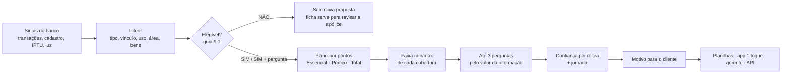

# Relatório de validação do projeto · 28/10/2026

Branch: `validacao/renda-liberada-e-relatorio` (a partir de `main` em `c9b1c2f`). Tudo o que está aqui foi conferido rodando o código e lendo os dados; quando algo é opinião ou proposta, está escrito assim.

---

## 0. Resumo em 1 minuto

**Veredito:** o projeto está maduro e defensável. O motor roda os 138 casos sem falha, as duas planilhas passam no validador com 0 erros, a geração é reprodutível (duas rodadas geram arquivos iguais) e há **91 testes passando**. O que mais diferencia o time é o **motivo**: todo cliente lê um porquê com um fato dele, quanto está em jogo e o que fica descoberto se escolher menos.

**O que mudou nesta branch:**
1. **Regra da renda retirada.** Na mentoria, o Banco do Brasil confirmou que renda não é dado sensível. A RN-07 foi revisada (decisão D-08) e a renda passou a reforçar a estimativa dos bens de quem não tem compras, junto com a média da região. Fora da amostra, o erro cai de **40,5% para 22,7%**. As planilhas da entrega não mudaram (todo caso da base comum tem compras).
2. **Números desatualizados corrigidos** no guia de pitch (16 não elegíveis, e não 24; 91 testes, e não 49; CUB oficial em 7 UFs) e no README (limitação do CUB).

**O que precisa de atenção antes das 10h de 29/10 (P0):**
- README sem **nome da equipe e integrantes** (`_(preencher)_`). O guia exige.
- Vídeo de até 5 minutos.
- O time decidir se faz merge desta branch na `main`.

---

## 1. O que estamos fazendo (explicado simples)

**Problema.** Só 17% dos lares brasileiros têm seguro (slide 6 da Brasilseg). Quem não tem não sabe quanto segurar, nem por que precisaria. A cotação tradicional pede ~20 campos que a pessoa não sabe responder (área, valor dos bens, padrão de acabamento).

**Ideia.** O banco já sabe muito: aluguel pago, parcela de financiamento, IPTU, conta de luz, compras de móveis e eletrônicos. O motor transforma esses sinais numa proposta pronta, diz o quanto confia em cada número e só pergunta o que realmente muda o resultado.

**Fluxo oficial do guia:** sinais → sugestão inicial → confiança → confirmação → recomendação.



**Uma ficha, vários canais.** A mesma saída (a "ficha" JSON) alimenta as 2 planilhas, o app do cliente, o painel do gerente e uma API para agentes (`motor/api.py`). Isso atende a RN-04 (lógica reaproveitável).

**Por que regras e não machine learning?** Não há rótulo (não sabemos qual plano era o certo, nem há sinistros na base). Um modelo aprenderia a copiar a renda. Regras com fonte e teste são explicáveis e o guia aceita (RN-48).

---

## 2. Como tratamos os dados

Cada dado que o motor mostra carrega **natureza** (observado, estimado, confirmado), **fonte legível**, **tipo de fonte** e **idade do sinal**. Isso responde à pergunta 4 do MVP ("o que foi observado, estimado ou confirmado?") e à RN-09.

| O que o motor precisa | De onde tira | Regra |
|---|---|---|
| **Tipo** (casa, casa em condomínio, apartamento) | Termos do endereço + conferência com o complemento (AP, BLOCO, TORRE × CASA, LOTE) | Divergência baixa a confiança e vira pergunta |
| **Vínculo** (inquilino, financiado, locador, proprietário) | Aluguel pago, parcela de financiamento, crédito recorrente compatível com aluguel | Sem sinal → "provável quitado", com pergunta |
| **Uso** (moradia, alugado a terceiros, veraneio) | Endereço principal compatível, crédito de aluguel, outro imóvel do cliente | Endereço que não bate e imóvel único → presumido |
| **Área** | Cadastrada (laudo, IPTU, cadastro municipal) ou estimada | Ver seção 3 |
| **Bens** | Compras de 36 meses (móveis, eletrodomésticos, eletrônicos) + bens vinculados ponderados pela chance de estarem no imóvel | Mínimo comprovado a preço de hoje (IPCA) até 2,7 × compras (estoque) |
| **Custo de reconstruir** | Área × custo do m² (SINAPI mín., CUB oficial máx.) × padrão construtivo | Terreno nunca entra (RN-56). Apartamento, condomínio ou financiado: segundo risco, 25% a 40% (acabamentos) |
| **Plano** | Pontos por sinal (aluguel, vizinhos, bens, eletrônicos, casa fora de condomínio, vidros, família declarada) | Total com 2+ pontos; Prático com 2 de Prático ou 1 + 1; senão Essencial |
| **Confiança** | Classe dos 5 dados críticos | Regra, não corte numa nota (com corte, 101 de 138 casos ficavam na borda) |
| **Jornada** | Elegibilidade, confiança, sinal de obra, uso do app, maturidade digital | Gerente é o último recurso |

**Calibração.** Tudo que é "aprendido" (IPTU por m², energia por m², médias regionais, razão compras/renda) vem da base de **desenvolvimento** (2.200 clientes, 2.578 imóveis) e é aplicado à base de **teste comum** (120 clientes, 138 imóveis). Os parâmetros ficam todos em `motor/parametros.py`, com a origem escrita ao lado.

---

## 3. As falhas da base, o efeito delas e como contornamos

Medido nas duas bases (desenvolvimento · teste comum):

| Falha nos dados | Tamanho | Efeito se ignorada | Como o motor contorna | Evidência |
|---|---|---|---|---|
| **Área não cadastrada** | 61% · **67%** (92 de 138) | Sem área não há custo de reconstrução, que é a maior cobertura | Área pelo **IPTU (peso 0,6) e pela energia (0,4)**, comparados à mediana por m² do município; faixa pelo erro real (percentis 10 e 90). Sem IPTU nem energia: mediana da região em degraus (município + tipo → município → estado) | Correlação da área: IPTU 0,82, energia 0,81, **renda 0,01**. Backtest fora da amostra: erro mediano **15%**, faixa contém a área real em **78%** (meta 80%) |
| **Padrão construtivo vazio** | 73% · **71%** (98) | Supor "normal" esconderia a incerteza | Faixa do econômico ao superior (0,85 a 1,30) + pergunta do acabamento. Com área cadastrada, o **IPTU/m² relativo ao município** estreita o padrão | 25 casos estreitados; o intervalo acerta o padrão real em **97,8%** fora da amostra |
| **Material da parede vazio** | 78% · **79%** (109) | Elegibilidade (material combustível) sem prova | Vazio não reprova (RN-19). Material diferente de alvenaria vira pergunta sobre madeira pré-fabricada ABNT | — |
| **CEP agregado e coordenadas fictícios** | 100% | Usar como local real inventaria risco | **Teste automático:** o CEP explica o IPTU/m² tanto quanto um CEP sorteado (R² 0,215 × 0,223), então não entra (`USAR_CEP = False`). Só município, UF e IBGE (RN-10) | `teste_cep` em `metricas.json` |
| **Seguro existente sem dizer a seguradora** | 30 casos com o campo | Reprovar todos seria errado (o veto é só para seguro BB no endereço) | NÃO só com **seguro + produto de seguridade BB + um imóvel** (16). Com dois imóveis ou sem produto BB: SIM + pergunta | 16 NÃO · 14 com pergunta |
| **Obra ou reforma não é campo** | 9 casos com gasto ≥ R$ 15 mil em material | Contratar imóvel em obra é vedado | Gasto alto vira pergunta "está em obra agora?" e manda ao gerente (o gasto sugere, não prova) | 9 pendências `POSSIVEL_REFORMA` |
| **Favela, área rural, MEI** | não existem na base | Inferir por bairro ou renda seria viés | Declaração na contratação; está nas limitações | RN-19 |
| **Sem sinistros nem rótulos** | — | Não há acurácia a medir | Coerência, estabilidade (±5% nos valores muda 1 plano; ±20% nos pesos muda 0 confianças), sensibilidade (área +10% → incêndio +4,6%, 0 quedas), reprodutibilidade, backtests fora da amostra | `metricas.json` |
| **Uso presumido** (endereço não bate, imóvel único) | 18 casos | Recomendar para quem talvez não more lá | Confiança BAIXA e gerente, com a pergunta "é onde você mora, veraneio ou alugado?" | `gerente_motivos` |
| **Compras e bens ausentes** | **0 casos** nas duas bases | — | Caminho defensivo: média da região, agora **com a renda** (ver seção 6). Sem região: piso de R$ 15 mil | Backtest: 40,5% → 22,7% |
| **Renda presumida** | 49% · 55% vêm "presumida com base em movimentação" | Renda é menos confiável que compras | A renda nunca substitui compras; só entra combinada | — |
| **IPTU ou energia zerados** (isenção, imóvel vazio) | 0 na base, comum na vida real | Área encolheria 60% | Usa só o sinal que existe, com o peso inteiro | `test_area_com_iptu_zerado_usa_so_a_energia` |

**Resumo para o pitch:** 67% sem área, 71% sem padrão e 79% sem material. Mesmo assim, 100% dos casos têm faixa, e quem tem menos dado recebe faixa mais larga e mais perguntas (largura do incêndio, máx ÷ mín: ALTA 1,89 · MÉDIA 2,33 · BAIXA 2,56).

---

## 4. As APIs e fontes externas: o que fazem e por quê

**Princípio:** o motor **não acessa a internet enquanto roda** (RN-12). Ele lê CSVs salvos em `motor/externos/`, e um script separado (`coletar.py --ao-vivo`) renova os que têm API. Se uma API falhar, o CSV salvo continua valendo, com a data. Sem um arquivo, o motor usa valor neutro e baixa a confiança.

| Fonte | Como chega | Entra no **valor** ou só no **texto**? | Para quê |
|---|---|---|---|
| **SINAPI** (IBGE) | **API SIDRA** (tabelas 6586 e 2296), set/2026 | Valor | Custo mínimo do m² por UF → reconstrução, vendaval, água, RC |
| **CUB R8-N** (Sinduscons) | Cópia manual; só `status = oficial` (SP, DF, GO, BA, MG, RS, PR) | Valor | Custo máximo do m². RJ, PE e CE: SINAPI × 1,14 (mediana da razão nas UFs oficiais) |
| **IPCA** (Banco Central) | **API SGS 433**, 12 meses (4,58%) | Valor | Traz as compras de 36 meses a preço de hoje: fator 1,069 |
| **FipeZAP Locação** (Fipe) | Cópia do informe set/2026 | Valor | Perda de aluguel de quem mora no próprio imóvel (R$/m² × área) |
| **Acionamentos do Residencial BB** (jan/2023–mai/2026) | Cópia de 4 percentuais divulgados pela BB | **Só texto** | "Danos elétricos são 53,3% dos acionamentos": mostra ao cliente que o risco é real |
| **Atlas Digital de Desastres / S2iD** (MIDR) | Resumo da base 1991–2025 das 10 capitais | **Só texto** | "Em Curitiba, a Defesa Civil registrou N ocorrências de chuvas intensas desde 1991" |
| **Ranking de continuidade ANEEL 2025** | Cópia de 10 linhas | **Só texto** | Posição da distribuidora de energia: reforça danos elétricos |
| **Condições Gerais BB v1.4** | PDF citado | Regras | Segundo risco, limite único, exclusões, roubo em residência desocupada |

**Por que o território fica só no texto?** Os registros dependem de o município informar à Defesa Civil; ausência de registro não é ausência de risco. Usá-los no valor seria tratar um dado incompleto como fato (RN-09). No texto, eles **conscientizam** sem distorcer a faixa.

---

## 5. O ponto principal: como o motor conscientiza o cliente

A banca disse que o **motivo** é o ponto principal (RN-49). O módulo `motor/motivo.py` escreve todo porquê com o mesmo roteiro:

1. **Um fato do próprio cliente** (das contas e do cadastro dele);
2. **Quanto está em jogo** (o valor em risco calculado);
3. **Como o plano resolve**;
4. **O que fica descoberto se escolher menos** ("Se você escolher menos, roubo e vidros ficarão descobertos: um arrombamento sairia do seu bolso");
5. **O que falta confirmar**, em linguagem simples, e a confiança.

**Exemplo real (perfil A, `IMO_CASO_00005_01`, apartamento financiado em Curitiba):**
> Recomendamos o plano Prático porque você gastou R$ 11 mil com vidraçaria nos últimos 2 anos, e vidro quebrado custa caro para repor. A estrutura tem o seguro do condomínio; o seu protege os acabamentos, cerca de R$ 105 mil, e os seus bens, de R$ 22 mil a R$ 60 mil. [...] Se você escolher menos, roubo e vidros ficarão descobertos: um arrombamento sairia do seu bolso. O Total acrescenta perda de aluguel e despesas emergenciais. Confiança alta: os dados vêm do seu cadastro e das suas contas.

**Exemplo real (perfil C, `IMO_CASO_00010_01`, veraneio):** o motor **não** empurra o Prático. Explica que o roubo do Prático não cobre residência desocupada e que fogo, água, vento e danos elétricos seguem cobertos. Isso mostra à banca que o motor protege o cliente, e não só vende.

**Como cada peça conscientiza:**
| Peça | O que o cliente entende |
|---|---|
| Valor em risco com número dele | "Reconstruir custaria R$ X, fora os seus bens de R$ Y" deixa de ser abstrato |
| Acionamentos reais da BB | Danos elétricos, água e vendaval somam **79,4%** dos acionamentos, e 100% das recomendações têm essas três coberturas |
| Território oficial | O risco de chuva e vento é da cidade dele, com data |
| "Se escolher menos" | A consequência concreta da escolha mais barata |
| Aviso de subseguro | Quando a estimativa passa do limite do produto: "o valor acima do limite fica descoberto" (Código Civil, art. 778) |
| Confiança dita em palavras | "A área foi estimada pelo IPTU e pela conta de luz": o cliente sabe o que conferir |

**Métricas do motivo** (`qualidade_do_motivo`): 0 motivos genéricos · 100% com fato do cliente · 100% com valor em risco · 100% com alternativa · 0 termos internos · mediana de 100 palavras (92% entre 60 e 120).

**Onde o motivo ainda é fraco (proposta):** o texto por cobertura é quase igual para todos em **impacto de veículos (1,4% de textos distintos)**, **queda de aeronave (0,7%)**, **quebra de vidros (12%)** e **RC familiar (36,7%)**. Impacto e aeronave são padrão do produto e tudo bem. Vidros e RC podem citar o tipo e a área do imóvel do cliente.

---

## 6. A renda: o que mudou e como defender

**Antes:** a RN-07 do time proibia a renda em tudo, e um pedido anterior de "usar o salário" foi recusado no vault (28/10, noite).
**Agora:** na mentoria, o pessoal do BB confirmou que renda não é dado sensível. A LGPD (art. 5º, II) também não a lista. A **idade** continua proibida.

**O que o motor faz com a renda (`motor/motor.py`):**
- Só em `estimar_bens`, quando **não há compras nem bens ligados ao imóvel**: compras estimadas = √(média da região × renda × razão compras/renda do município), **presa entre 0,5 × e 2 × a média da região**.
- Quem tem compras segue pelas compras (a prova vence a estimativa).
- Não entra em plano, elegibilidade, jornada nem confiança, **nem por tabela**: bens presumidos não somam os pontos de "bens altos" e "eletrônicos" do plano (achado da revisão de código, seção 11).
- A razão compras/renda de um município só vale com 20 imóveis ou mais; senão, usa a razão geral.
- O cliente lê: "usamos a média de casas parecidas na sua região **e a sua renda**".
- Desligável: `parametros.RENDA_NOS_BENS_SEM_COMPRAS = False`.

**Evidência (`backtest_bens_sem_compras`, 2.578 imóveis, duas metades):**
| Estimativa das compras de quem "não tem" | Erro mediano |
|---|---|
| Só a média da região | 40,5% |
| Região + renda (média geométrica) | **22,7%** |
| Só a renda (análise à parte, não usada) | ~37% |

**Ressalva honesta:** o backtest só pode medir em quem **tem** compras (fingindo que não tem). O público real desse caminho (quem compra com cartão de outro banco ou tem poucos bens) pode ser diferente, então 22,7% é um número otimista para ele. As metades também são divididas por linha, não por cliente; um cliente com dois imóveis pode cair nas duas (vazamento pequeno).

**Por que não usar a renda em mais coisas (ainda):** na base, a renda tem correlação **0,88** com os bens, mas **0,01** com a área. Na base comum, 0 casos estão sem compras, então hoje a mudança não altera nenhuma planilha. Ela protege o cliente real que compra com cartão de outro banco.

**Próximo uso proposto (não implementado):** em **29 dos 138 casos** a renda indica compras pelo menos 1,5 × maiores que as vistas no BB (8 casos acima de 2 ×). Em vez de mudar o valor, isso pode virar uma pergunta: "Você comprou coisas para a casa com cartão de outro banco?". Ajuda contra o subseguro sem a renda decidir sozinha.

**Como falar na banca:** "O guia fala em atributos pessoais. Na mentoria, o BB confirmou que renda não é dado sensível, e mesmo assim ela nunca decide sozinha: só reforça os bens de quem não tem compras, e o cliente é avisado." A tabela de justiça por quinto de renda continua no `metricas.json`: a elegibilidade fica parecida em todas as faixas (regra dos 80%: **0,85**).

---

## 7. Validação: o que está bom

| Item | Evidência conferida |
|---|---|
| Executa sem falha | 138 de 138 casos, 0 falhas, ~0,7 s |
| Planilhas no padrão do guia | Validador (`templates.py`): colunas, ordem, nomes do catálogo, valores só com números, fixas completas, RN-33 (lista = linhas). **0 erros** |
| Reprodutível | Regenerei a entrega da `main`: só o tempo de execução mudou |
| Testes | 82 na `main` → **91** nesta branch, todos passando; CI no GitHub roda a cada envio |
| Elegibilidade antes do plano | NÃO só com prova (16); sinal fraco vira pergunta (21 elegíveis com confirmação) |
| Faixas coerentes | Menor confiança → faixa mais larga; área maior nunca reduz incêndio |
| Esforço | 2,7 perguntas por caso contra ~19,9 campos de uma cotação tradicional (**86,4% menos**); nenhuma pergunta que mude menos de R$ 5 mil |
| Gerente como último recurso | 1 toque 67 · app com perguntas 20 · gerente 35 (29% dos elegíveis) · sem nova proposta 16. STP 63% |
| Fontes | Todas públicas, com data, licença, método e limitação em `FONTES.md`; APIs validam a resposta antes de gravar |
| Privacidade | Sem credenciais; idade fora de tudo; renda num ponto só e avisada |

## 8. Validação: o que melhorar (priorizado)

### P0: antes da entrega (29/10, 10h)
1. **README:** nome da equipe, integrantes e turma estão como `_(preencher)_`. O guia exige (RN-42).
2. **Vídeo** de até 5 min (roteiro pronto no guia de pitch).
3. **Merge desta branch**, se o time concordar com a regra da renda. Sem merge, a `main` segue dizendo "renda nunca".
4. **Vault local desatualizado:** a cópia no OneDrive (`Datathon Protecao Inteligente/BB Datathon`) está atrás da do repositório (falta a nota "Plano - motivo, dados faltantes e gerente" e o painel diz 64 testes). Copiar a pasta `obsidian/` do repositório por cima.

### P1: riscos que a banca pode apontar
| # | Achado | Números | Sugestão |
|---|---|---|---|
| 1 | **Limites do produto prendem as faixas.** Máximos de danos por água (R$ 50 mil) e danos elétricos (R$ 30 mil) são **premissa** (sem print) | Água no teto em **134 de 138**; elétricos em **122**; vendaval em 66 | Confirmar os limites reais com a BB ou no app; senão, deixar claro na banca que são premissa |
| 2 | **Confiança por cobertura quase constante.** A confiança geral varia (ALTA 17 · MÉDIA 101 · BAIXA 20), mas 9 das 11 coberturas saem **MÉDIA em 100% das linhas** (só perda de aluguel e vidros variam) | Incêndio: 138 de 138 MÉDIA | Derivar a confiança da cobertura da área (observada × estimada) e do padrão, como a confiança geral. Muda as planilhas: decidir com cuidado |
| 3 | **Escolher o mínimo da faixa gera subseguro** | ITV no mínimo: mediana 0,60; **117 casos** abaixo de 80% | No app, sugerir o meio da faixa como valor padrão |
| 4 | **Faixa da área contém a real em 78%** (meta 80%) | Backtest | Alargar um pouco os percentis (ex.: 8 e 92) |
| 5 | **Família muda o plano em 18 casos** (dependentes e pet somam 1 ponto ao Total) | Valor, elegibilidade, canal e confiança: 0 mudanças | Decisão pendente no vault; manter e explicar pelo slide 14, ou deixar só a RC como adicional |
| 6 | **Inquilino de casa paga a reconstrução**, que é do dono | Lei do Inquilinato, art. 22, VIII | Pergunta "o contrato pede que você faça o seguro do imóvel?" |
| 7 | **RC adicional em veraneio de apartamento** com dependentes ou pet | Caso C mostra a frase | Avaliar se faz sentido para imóvel vazio |

### P2: melhorias de conscientização (propostas)
- Pergunta das **compras fora do BB** (29 casos, seção 6).
- Texto de **vidros e RC** com o tipo e a área do imóvel (seção 5).
- **"Simulador de imprevisto"** (já está nas ideias do vault): "se um cano estourar hoje, sem seguro sairia R$ X do seu bolso", com os números da ficha.
- DEC/FEC por conjunto elétrico (ANEEL, dados abertos) em vez do ranking da distribuidora inteira.

---

## 9. Como conferir

```bash
pip install -r requirements.txt
python -m pytest -q                 # 91 passed
python motor/gerar.py --entrega     # erros_validacao: 0
```

O que rodei nesta revisão (Python 3.11.9, pandas 2.2.3, pytest 8.3.3):
- `pytest` na `main`: 82 passed · nesta branch: **91 passed**.
- `gerar.py --entrega` na `main` e nesta branch: 0 erros; as duas planilhas ficaram **idênticas byte a byte**; `metricas.json` ganhou `bens_pela_regiao_e_renda` (0) e `backtest_bens_sem_compras` (40,5 → 22,7).
- Análises de lacunas, correlações e backtests nas duas bases (seções 3 e 6).

## 10. O que mudou nesta branch

| Arquivo | Mudança |
|---|---|
| `motor/parametros.py` | `RENDA_NOS_BENS_SEM_COMPRAS` e a regra do projeto revisada |
| `motor/motor.py` | `calibrar` lê a renda dos clientes; `_compras_por_renda`, `compras_pela_renda`, `_compras_sem_prova`, `backtest_bens_sem_compras`; `estimar_bens` usa região + renda quando não há compras |
| `motor/motivo.py` | Texto da confiança avisa quando a renda entrou |
| `motor/metricas.py` | `dados_faltantes` com a contagem e o backtest |
| `tests/test_motor.py` | 9 testes novos e 2 reescritos (82 → 91) |
| `entrega/metricas.json` | Novas métricas (as planilhas não mudaram) |
| README, vault, guia de pitch, especificações, protótipos | Regra da renda retirada (idade segue proibida), D-08, números atualizados |
| `documentos/contexto/22-renda-liberada.md` | Documento da etapa |

## 11. Revisão de código da mudança da renda

Um revisor independente leu o diff, rodou os testes, regenerou as saídas numa pasta temporária (planilhas com o mesmo hash) e simulou os 138 casos sem compras, com rendas de 0 a R$ 150 mil. Veredito inicial: **pronto com correções**. Tudo abaixo foi corrigido com teste escrito antes (falhou, depois passou):

| Achado | Gravidade | Correção | Teste |
|---|---|---|---|
| No caminho sem compras, a renda mudava o **plano** pelos limiares de bens (83 de 138 casos simulados) | Importante | Bens presumidos não somam pontos de "bens altos" e "eletrônicos" | `test_sem_compras_renda_nao_muda_plano_nem_jornada` |
| O cliente sem compras lia "suas compras ... valem pelo menos R$ X" e "repor o que você comprou" | Importante | Textos dizem "estimamos" e "os seus bens, que estimamos" quando não há compras | mesmo teste |
| Renda em texto ("5000") quebrava o `brl()` | Menor | `_renda()` converte com segurança; inválida → só região | `test_renda_em_texto_ou_invalida_nao_quebra` |
| Razão compras/renda sem amostra mínima por município | Menor | Exige 20 imóveis (`REGIONAL_MIN_IMOVEIS`) | `test_razao_compras_renda_exige_amostra_minima` |
| Influência da renda sem limite (renda de R$ 150 mil → ~4 × a região) | Menor | Resultado preso entre 0,5 × e 2 × a região | `test_renda_nao_passa_de_2x_a_regiao` |
| Merge com clientes poderia derrubar imóveis da calibração | Menor | `how="left", validate="many_to_one"` | suíte inteira |
| Métrica de bens pela região contava os casos com renda; teste de justiça contaria como "mudou" um caso sem compras | Menor | Contagens separadas; sem compras, o teste de justiça confere só plano, elegibilidade, jornada e confiança (`teste_justica_casos_sem_compras_so_decisoes`) | `test_metricas_e_casos` |
| Comentários antigos ("a renda não entra no motor") | Menor | Atualizados | — |

Resultado depois das correções: **91 testes passando**, backtest ainda 40,5% → 22,7%, planilhas da entrega **idênticas** às da `main`.
