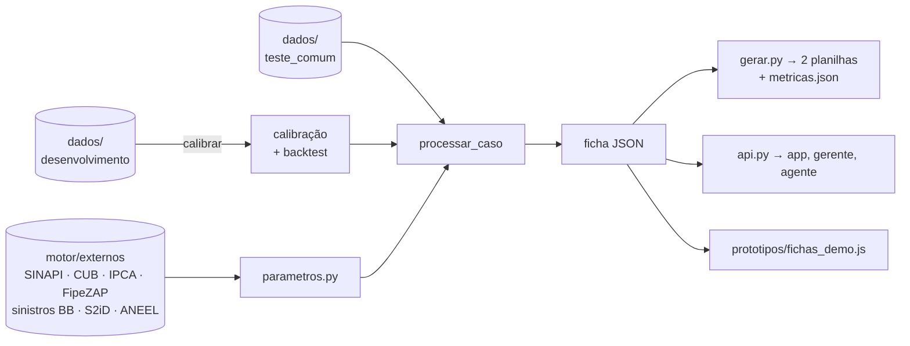

# 🧭 Mapa do código

O que cada arquivo e cada função do motor faz, em linguagem simples. O código fica no repositório [pedroiaan/datathon-protecao-inteligente](https://github.com/pedroiaan/datathon-protecao-inteligente), na pasta `motor/`.

> [!codigo] Como tudo se liga
> **Dados do banco** → `motor.py` (inferir → elegibilidade → plano → coberturas → perguntas → confiança) → **ficha** de cada cliente-imóvel → `gerar.py` grava as **2 planilhas**, as **métricas** e as **fichas da demo**. A API (`api.py`) devolve a mesma ficha para o app, o gerente ou um agente.
> Toda premissa numérica fica em `parametros.py`. As fontes externas ficam salvas em `motor/externos/`, então **nada acessa a internet enquanto o motor roda** (RN-12).



## 📁 Arquivos
| Arquivo | Para que serve |
|---|---|
| `motor/motor.py` | O motor: lê os dados, infere o imóvel, decide elegibilidade, plano, faixas, perguntas e confiança, e monta a ficha |
| `motor/parametros.py` | Todas as premissas e tabelas externas, cada uma com a origem escrita ao lado |
| `motor/motivo.py` | **O texto que o cliente lê**: o porquê da recomendação e o que fica descoberto. Só escreve; não decide nada |
| `motor/gerar.py` | Roda tudo de ponta a ponta e grava as planilhas da entrega |
| `motor/metricas.py` | Calcula as provas para a banca: justiça, estabilidade, backtest e métricas de mercado |
| `motor/templates.py` | Confere se as 2 planilhas obedecem ao guia antes de gravar |
| `motor/api.py` | API de demonstração (FastAPI): a mesma ficha para qualquer canal |
| `motor/externos/` | Fontes externas salvas (CSV) + `FONTES.md` (licença, data, limitações) + `coletar.py` (atualiza o IPCA) |
| `tests/` | 111 testes automáticos (`python -m pytest -q`) |
| `entrega/` | As 2 planilhas finais, `metricas.json` e `casos_contrastantes.json` |
| `prototipos/` | O protótipo com gerente, que lê `fichas_demo.js` |

---

## ⚙️ `motor.py`, função por função

### Carregar e calibrar
| Função | O que faz |
|---|---|
| `carregar(origem)` | Lê as 5 tabelas, os 2 templates e o catálogo, de uma pasta ou direto do `.zip` da organização |
| `calibrar(dados)` | Na base de desenvolvimento, aprende quanto custa o IPTU e a energia por m² em cada município. Também guarda o **backtest** |
| `_calibrar_area(a)` | A conta da calibração: medianas de IPTU/m² e energia/m², faixa de erro (q10–q90) e área típica por município e tipo |
| `backtest(a)` | **Validação fora da amostra:** calibra em metade dos imóveis e mede na outra metade. Mede o erro da área e se o padrão estimado pelo IPTU acerta |
| `_positivo(v)` | Diz se um número existe e é maior que zero |
| `_area_estimada(r, cal)` | Estima a área pelo IPTU (peso 0,6) e pela energia (0,4). Se um dos dois faltar, usa só o outro |
| `iptu_relativo(r, cal)` | IPTU/m² do imóvel ÷ mediana do município. Só com área cadastrada, para não ficar circular |

### Ferramentas pequenas
| Função | O que faz |
|---|---|
| `_degraus(df, coluna)` / `regional(cal, campo, r)` | **Média da região em degraus** para o que falta: município + tipo → município → estado → geral, só com 20 ou mais imóveis |
| `teste_cep(a)` | Prova que o CEP da base é ruído (R² igual ao de um CEP sorteado), por isso o degrau de CEP fica desligado (RN-10) |
| `dado(...)` | Cria um dado com valor, natureza (observado, estimado, confirmado), confiança, fonte e idade |
| `arred(v)` | Arredonda reais: de 500 em 500 até R$ 20 mil e de 1.000 em 1.000 acima disso |
| `faixa(lo, hi, cob)` | Põe a faixa dentro dos limites do produto e arredonda |
| `pior(*confs)` | Devolve a pior confiança entre várias |
| `brl(v)` | Formata em reais (`R$ 12.000`) |

### Inferir o imóvel
| Função | O que faz |
|---|---|
| `tipo_pelo_complemento` | Lê o complemento do endereço (AP, BLOCO, CASA, LOTE...) |
| `inferir_tipo(r)` | Apartamento, casa em condomínio ou casa, pelos termos do endereço. Marca quando o complemento diverge |
| `inferir_vinculo(r)` | Inquilino (paga aluguel), financiado (paga parcela), locador (recebe aluguel) ou proprietário |
| `inferir_uso(r, outro_principal)` | Moradia habitual, alugado a terceiros ou veraneio |
| `inferir_area(r, cal)` | Área cadastrada, ou estimada pelo IPTU e pela energia com faixa de erro, ou mediana de imóveis parecidos |
| `_ancoras(compras, bens)` | As 3 âncoras dos bens: mínimo comprovado e máximo de estoque (2,7 × compras), a preço de hoje (IPCA) |
| `estimar_bens(r, bens)` | Faixa dos bens por categoria (eletrônicos, eletrodomésticos, móveis) e as bases de roubo, danos elétricos e água. **Nunca lê idade, dependentes ou pet.** A renda só entra sem compras nem bens (`_compras_sem_prova`, D-08) |
| `compras_pela_renda(r, cal)` · `backtest_bens_sem_compras` | Compras esperadas pela renda (razão compras/renda do município) e o teste fora da amostra que justifica usar região + renda (40,5% → 22,7% de erro) |
| `valor_imovel(r, tipo, vinculo, area, cal)` | Custo de reconstruir: área × custo do m² (SINAPI a CUB) × padrão. Sem padrão cadastrado, o IPTU/m² estreita o fator. Marca o segundo risco |

### Decidir
| Função | O que faz |
|---|---|
| `avaliar_elegibilidade(r, uso, n_imoveis)` | "Não" só com prova. Sinal fraco (obra, material, seguro de outra seguradora) vira pergunta |
| `familia_declarada(r)` | Dependentes no cadastro e pet informado. Só serve para a necessidade de RC |
| `avaliar_necessidades(...)` · `escolher_plano(...)` | As três necessidades (aluguel, roubo e vidros, terceiros), cada uma com prova e força; o plano é o menor que cobre. Detalhes em [[10 - Dicionário de funções]] |
| `faixa_bruta_incendio(ctx)` | Reconstrução + bens, ou só acabamentos + bens no segundo risco |
| `dimensionar(cob, ctx)` (confiança e sugerido) | Cada cobertura sai com a **confiança dos dados que usa** (área, padrão, bens, fonte) e um **valor sugerido** (meio da faixa; no incêndio, o valor em risco) |
| `dimensionar(cob, ctx)` | A faixa mínima e máxima de cada cobertura, com regra, justificativa, o que confirmar e observação. Avisa quando a estimativa passa do limite do produto (subseguro) |
| `contexto_territorio(cob, r)` | A frase com dado oficial do município: Defesa Civil para água e vento, ANEEL para danos elétricos. Sem dado ou com zero registros, devolve vazio |
| `coberturas_adicionais(r, tipo, plano)` | RC familiar como adicional em prédio ou condomínio com dependentes ou pet |

### Perguntar e medir a confiança
| Função | O que faz |
|---|---|
| `valor_da_informacao(...)` | Quanto cada resposta aperta a faixa de incêndio, limitado à largura real que entregamos |
| `montar_perguntas(...)` | Até 3 perguntas: elegibilidade primeiro, depois as que mudam o plano e as que mais apertam a faixa. Corta as que mudam menos de R$ 5 mil. Marca cada uma como **obrigatória** (elegibilidade e `PERGUNTAS_QUE_TRAVAM`: uso e tipo duvidosos) ou **opcional** (só ajusta valor) |
| `peso_dado(d, campo)` | Nota de 0 a 1 = peso da fonte × frescor (dado antigo vale menos) |
| `campos_faltantes(r)` | Quais campos do imóvel vieram vazios |
| `classe_dado(d, campo)` | Observado, estimado ou presumido. Observado mais velho que a meia-vida conta como estimado |
| `confianca_geral(...)` | Alta, média ou baixa por regra, com o motivo |

### Montar a saída
| Função | O que faz |
|---|---|
| `escolher_jornada(...)` | 1 toque (nenhuma pergunta obrigatória), app com perguntas (obrigatória ou confiança baixa: o app pergunta antes), gerente (só obra ou sem app) ou sem nova proposta, com o motivo |
| `processar_caso(...)` | Junta tudo e devolve a **ficha** de um cliente-imóvel |
| `processar(dados, cal)` | Roda `processar_caso` para todos os imóveis da base |
| `justificativa(f)` | Chama `motivo.justificativa`: fato do cliente, valor em risco, "Se você escolher menos..." (slide 23), opção acima, o que confirmar e confiança |
| `para_templates(fichas, template)` | Transforma as fichas nas 2 planilhas, na ordem do template |
| `_limpo(v)` | Converte números do numpy para gravar em JSON |

---

## 🧮 `parametros.py`
| Nome | O que é | Origem |
|---|---|---|
| `custo_m2(uf)` / `fonte_custo(uf)` | Custo do m² (mínimo SINAPI, máximo CUB oficial ou SINAPI × razão) | IBGE, Sinduscons |
| `FATOR_PADRAO`, `fator_padrao()` | Econômico 0,85 · normal 1,0 · superior 1,30 · vazio 0,85–1,30 | Premissa do time |
| `fator_padrao_pelo_iptu()` | IPTU/m² < 0,90 × município: descarta o superior. > 1,15: descarta o econômico | Calibrado na base de desenvolvimento |
| `FRACAO_ACABAMENTOS` | 25%–40% da reconstrução no segundo risco | CG cl. 15.2 |
| `FATOR_IPCA` | Compras de 36 meses a preço de hoje | Banco Central, série 433 |
| `aluguel_m2(uf)` | Aluguel por m² da capital | FipeZAP set/2026 |
| `sinistros_pct(cob)` | % dos acionamentos do residencial BB por cobertura (só no texto) | BB Seguros, jan/2023–mai/2026 |
| `desastres(codigo_ibge)` | Registros de água e vento no município (só no texto) | Atlas Digital de Desastres / S2iD |
| `continuidade_energia(codigo_ibge)` | Distribuidora e posição no ranking de quedas de energia (só no texto) | ANEEL, ranking 2025 |
| `LIMITES_PRODUTO` | Mínimo e máximo de cada cobertura | Prints do app; os máximos sem print são premissa |
| `BENS_RELEVANTES`, `PORTATEIS_RELEVANTES` | Cortes de pontos para o Prático | Mediana da base de desenvolvimento |
| `PESO_FONTE`, `MEIA_VIDA_MESES`, `CLASSE_FONTE` | Qualidade do dado: precisão, atualidade e classe | Premissa do time (BCBS 239) |
| `MAX_PERGUNTAS`, `VALOR_MINIMO_PERGUNTA` | No máximo 3 perguntas; nenhuma que mude menos de R$ 5 mil | RN-36, RN-51 |

## 📊 `metricas.py`
| Função | O que faz |
|---|---|
| `calcular_metricas(...)` | Todas as métricas do guia §8: processados, justificativa, completude, justiça, estabilidade, sensibilidade, tempo |
| `qualidade_do_motivo(fichas)` | Motivos genéricos, fato do cliente, valor em risco, alternativas, jargão, tamanho e personalização das coberturas |
| `dados_faltantes(fichas, cal)` | Como cada lacuna foi tratada (cadastro, IPTU e energia, região, pergunta) |
| `metricas_de_mercado(fichas)` | STP, esforço economizado, ITV (subseguro), faixas limitadas pelo produto e aderência aos sinistros reais da BB |
| `renda_por_quinto(m, por_id)` | Tabela de justiça por quinto de renda e regra dos 80% na elegibilidade |
| `casos_contrastantes(fichas)` | Escolhe os casos da demo: os 3 perfis do slide 14, o não elegível, o 1 toque, o inquilino e o "a confirmar" |
| `_incendio_meio(f)` | Meio da faixa de incêndio, usado na sensibilidade |

## ✅ `templates.py`
`validar_templates(...)` confere as colunas e a ordem do template, os campos obrigatórios, o SIM/NÃO, o motivo de cada NÃO, os nomes do catálogo, os valores inteiros e não negativos, a confiança (ALTA/MEDIA/BAIXA), as linhas repetidas, as coberturas fixas do plano e a **RN-33**: a lista de coberturas da planilha 1 tem de ser igual às linhas da planilha 2.

## 🚀 `gerar.py`
| Função | O que faz |
|---|---|
| `gerar(saida, entrega)` | Calibra, processa os 138 casos, valida, grava e calcula as métricas. Com `--entrega`, copia para `entrega/` |
| `resumo(fichas, segundos)` | O resumo impresso no terminal |
| `escrever_fichas_demo(...)` | Grava `prototipos/fichas_demo.js` com as fichas dos casos contrastantes |

## 🌐 `api.py`
| Rota | O que faz |
|---|---|
| `GET /saude` | Diz se a API está no ar |
| `GET /fichas/{imovel_id}` | A ficha completa de um imóvel da base de teste |
| `POST /recomendar` | Recalcula com as respostas do cliente (bens "menos/isso/mais", área). Área 0 ou negativa é recusada (422) |

## 🔄 `externos/coletar.py`
`--ao-vivo` (`atualizar_tudo`) renova o SINAPI pela API SIDRA do IBGE e o IPCA pela API do Banco Central, validando antes de gravar; se uma falhar, o CSV salvo fica. `atualizar_ipca()` baixa os últimos 12 meses do IPCA. `resumir_atlas(csv)` (`--atlas`) transforma a base do Atlas de Desastres na tabela das 10 capitais. **Só rodam quando alguém quer atualizar**; o motor nunca chama.

---

## Como rodar
```bash
pip install -r requirements.txt
python -m pytest -q
python motor/gerar.py --entrega
```

Ligações: [[Plano - motivo, dados faltantes e gerente]] · [[Auditoria do código - 28-10]] · [[Métricas do mercado x as nossas]] · [[Log de alterações do código]] · [[Regras de negócio]]
