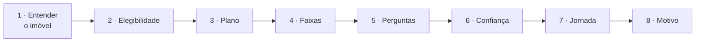

# ⚙️ 02 · O motor passo a passo

Para cada cliente-imóvel, `motor.processar_caso` faz 8 passos e devolve a **ficha**. Tudo são regras escritas (sem caixa-preta), e toda premissa numérica está em `motor/parametros.py`.



## 1 · Entender o imóvel
| Dado | Regra | Exemplo |
|---|---|---|
| **Tipo** | Termo "apartamento" no endereço → apartamento; "condomínio" → casa em condomínio; senão, casa. O complemento (AP, BLOCO, CASA, LOTE) confirma ou levanta dúvida | "BLOCO B APTO 305" confirma apartamento |
| **Vínculo** | Paga aluguel → inquilino; paga parcela → financiado; recebe aluguel e não mora → locador; senão → proprietário (inferido) | Parcela de R$ 950 → financiado |
| **Uso** | Endereço principal → moradia; recebe aluguel → alugado a terceiros; mora em outro imóvel → veraneio; senão, dúvida (cadastro desatualizado?) | — |
| **Área** e **bens** | Ver [[01 - Os dados e como tratamos]] | 110 m² (IPTU) · bens de R$ 22 mil a R$ 60 mil |
| **Valor da casa** | Área × custo do m² (SINAPI a CUB) × padrão; segundo risco = 25% a 40% | — |

## 2 · Elegibilidade (antes de tudo; RN-15)
| Situação | Resultado |
|---|---|
| Situação cadastral não regular (tombado, desapropriado, condenado) | **NÃO** |
| Seguro residencial + produto de seguridade BB + um único imóvel | **NÃO** (provável seguro BB no endereço) |
| Seguro residencial sem produto BB | SIM + pergunta obrigatória "O seu seguro atual é da BB Seguros?" |
| Seguro residencial e mais de um imóvel | SIM + pergunta "Qual dos seus imóveis já tem o seguro da BB?" |
| R$ 15 mil ou mais em material de construção em 24 meses | SIM + pergunta "Está em obra ou reforma?" (obra impede) |
| Parede de outro material que não alvenaria | SIM + pergunta "É madeira pré-fabricada certificada?" |

**Regra de ouro (RN-19):** sinal fraco nunca vira NÃO; vira pergunta. Por isso, desde 29/10, "seguro residencial + produto de seguridade BB" (produto que pode ser vida ou previdência) também vira **pergunta obrigatória** ("O seu seguro atual é da BB?"). Resultado: SIM 138 · NÃO só com situação cadastral irregular (nenhum na base).

## 3 · Plano: as três necessidades (desde 29/10)
O motor **não soma pontos**. Ele faz três perguntas sobre o cliente. Cada "sim" precisa de uma **prova** (um dado do próprio cliente) e aponta a **cobertura que resolve**:

| Necessidade | Acende quando (a prova) | Cobertura que resolve | Está em |
|---|---|---|---|
| **A · Aluguel em jogo** | Paga aluguel deste imóvel, **ou** recebe aluguel dele | Perda de aluguel | só no **Total** |
| **B · Roubo e vidros** | Bens comprovados ≥ R$ 36 mil, **ou** eletrônicos ≥ R$ 10 mil, **ou** gastou com vidraçaria nos últimos 2 anos | Roubo e quebra de vidros | **Prático** e Total |
| **C · Danos a terceiros** | Mora em prédio ou condomínio (o vizinho está colado), **ou** tem dependentes ou pet | RC familiar | no Total; nos outros, **adicional** |

**Exceções da necessidade B:** não acende em imóvel de **veraneio** (o roubo não cobre casa desocupada, CG Roubo 2.1 c) nem com bens **presumidos** (sem compras, a estimativa não é prova). "Casa fora de condomínio" não acende B sozinha: é um agravante citado no motivo quando B já acendeu.

**O plano é o menor que cobre as necessidades:**
```
Tem A (aluguel)?   ── sim ──► TOTAL (já tem roubo, vidros e RC)
        │ não
Tem B (roubo)?     ── sim ──► PRÁTICO  (+ RC adicional se tiver C)
        │ não
                   ──────────► ESSENCIAL (+ RC adicional se tiver C)
```

**Por que esses limites:** R$ 36 mil e R$ 10 mil são as **medianas** da base de desenvolvimento ("mais que a metade das casas"). Não temos dado de sinistro nem de preço para um limite atuarial. Por isso existe a força da recomendação.

**Força da recomendação**
- **Clara:** a prova que decide está a mais de 15% do limite. Ex.: R$ 49 mil em bens; paga R$ 3 mil de aluguel; gastou com vidros.
- **No limite:** o valor que decide está a menos de 15% do limite, para cima ou para baixo. Ex.: R$ 9.411 em eletrônicos (limite de R$ 10 mil).
- **No limite** → o motor (1) faz a **pergunta decisiva** ("Seus eletrônicos valem mais de R$ 10 mil?"), (2) avisa no motivo ("você está perto de precisar do Prático") e (3) marca a ficha para o gerente.

**Exemplos reais**
| Cliente | A | B | C | Plano | Força |
|---|---|---|---|---|---|
| Inquilino em Fortaleza (`00008`) | paga aluguel | — | prédio | **Total** | clara |
| Apartamento em Curitiba (`00005`) | não | gastou R$ 11 mil com vidros | prédio + dependente | **Prático + RC** | clara |
| Casa em Porto Alegre (`00015`) | não | não (eletrônicos R$ 8.983, perto de R$ 10 mil) | dependente | **Essencial + RC** | **no limite** → pergunta decisiva |

**Resultado (base de teste):** Prático 66 · Total 38 · Essencial 34 · RC adicional 93 · força clara 124 · no limite 14.
**O que nunca entra:** renda, idade, dependentes e pet nunca acendem A nem B. Dependentes e pet só acendem C (a RC).

## 4 · Faixas de cada cobertura
| Cobertura | Mínimo → máximo | Limite do produto |
|---|---|---|
| Incêndio | reconstrução + bens (segundo risco: 25%–40% da reconstrução + bens; **inquilino de casa: só os bens**, porque a estrutura é do locador, Lei do Inquilinato art. 22, VIII) | R$ 100 mil a R$ 600 mil |
| Danos por água | 50%–100% dos bens molháveis + 3%–8% da reconstrução | R$ 3 mil a R$ 50 mil |
| Vendaval e granizo | casa 10%–20% da reconstrução · apartamento 2%–5% | R$ 1 mil a R$ 60 mil |
| Impacto de veículos | casa R$ 10–20 mil · apartamento R$ 10 mil | até R$ 20 mil |
| Queda de aeronave | R$ 10 mil (padrão) | até R$ 20 mil |
| Danos elétricos | eletrônicos + eletrodomésticos: comprovado → estoque | R$ 5 mil a R$ 30 mil |
| Roubo | eletrônicos: comprovado → estoque | R$ 1 mil a R$ 45 mil |
| Quebra de vidros | casa R$ 3–8 mil · apartamento R$ 2–5 mil; ampliada para 1,2 × o gasto com vidraçaria | R$ 1 mil a R$ 25 mil |
| RC familiar | prédio: área do imóvel (vizinho do mesmo tamanho) × custo do m² × 30%–60% · casa: R$ 30–60 mil | R$ 10 mil a R$ 200 mil |
| Perda de aluguel | aluguel pago ou recebido × 6 a 12 meses; senão FipeZAP × área × 6 a 12 | R$ 5 mil a R$ 30 mil |
| Despesas emergenciais | 2%–5% da faixa de incêndio | R$ 2 mil a R$ 15 mil |

Depois, cada faixa vai para dentro do limite do produto e é arredondada (de 500 em 500 até R$ 20 mil, de 1.000 em 1.000 acima). Se a estimativa passa do limite, a observação avisa que o excedente fica descoberto. Cada cobertura também traz um **valor sugerido** (meio da faixa; no incêndio, o valor em risco), para o app não puxar o mínimo e gerar subseguro.

## 5 · Perguntas (até 3)
| Prioridade | Pergunta | Tipo |
|---|---|---|
| 95–100 | Elegibilidade (seguro BB? obra? material?) | **obrigatória** |
| 70 | "É onde você mora, veraneio ou alugado?" (uso duvidoso) | **obrigatória** |
| 65 | **Pergunta decisiva** (recomendação no limite): "Seus eletrônicos valem mais de R$ 10 mil?" ou "Sua casa tem mais de R$ 36 mil em bens?" | opcional |
| 60 | "Você recebe aluguel deste imóvel?" | opcional |
| 59 | Inquilino de casa: "O contrato pede que você segure o imóvel?" | opcional |
| 58 · 56 · 54 | Bens, área, acabamento, **na ordem de quanto cada resposta aperta a faixa** | opcional |
| 40 | "É apartamento ou casa?" (complemento diverge) | **obrigatória** |
| 30 | "O imóvel é seu e já está quitado?" | opcional |

Pergunta de valor que aperta a faixa em menos de R$ 5 mil não é feita, e nenhuma promete apertar mais do que a largura da faixa entregue. **Obrigatória trava a contratação; opcional só ajusta o valor.** Média: 2,75 perguntas por caso, sendo 0,46 obrigatória; 80 casos não têm nenhuma obrigatória.

## 6 · Confiança
**Geral (do caso):** cada dado crítico (tipo, vínculo, uso, área, bens) é **observado** (documento, transação ou confirmado), **estimado** (derivado ou inferido) ou **presumido**. Observado mais velho que a meia-vida do campo conta como estimado.
- **BAIXA:** área ou bens presumidos, ou algum presumido junto com estimado.
- **ALTA:** os 5 observados, elegível e sem pendência.
- **MÉDIA:** o resto. Resultado: alta 17 · média 101 · baixa 20.

**Por cobertura:** o pior dos dados que a cobertura usa. Incêndio: área, padrão, bens e fonte; vendaval: área, padrão e fonte; danos elétricos e roubo: bens. Assim, danos elétricos saem ALTA em 69 casos e o incêndio só é ALTA com área e padrão cadastrados.

## 7 · Jornada (gerente em último caso)
| Jornada               | Quando                                                                                                                                                                        | Casos                  |
| --------------------- | ----------------------------------------------------------------------------------------------------------------------------------------------------------------------------- | ---------------------- |
| **1 toque**           | Nenhuma pergunta obrigatória: contrata com a faixa sugerida                                                                                                                   | 63                     |
| **App com perguntas** | Pergunta obrigatória (elegibilidade, "seu seguro é da BB?", uso duvidoso) ou pouca familiaridade com o app. Na confiança baixa, o app pergunta primeiro e o gerente entra se a resposta mudar o caso | 49 |
| **Gerente** | Sinal de obra (10) ou cliente sem o app (16) | 26 (19%) |
| **Sem nova proposta** | Não elegível com prova, ou o cliente respondeu que o seguro atual é da BB | 0 na base |

O campo `canal` (1 toque × gerente) continua existindo para o protótipo.

## 8 · Motivo (o porquê; `motor/motivo.py`)
Roteiro fixo, em linguagem de cliente:
1. **Fato dele:** "você gastou R$ 11 mil com vidraçaria nos últimos 2 anos".
2. **Quanto está em jogo:** "reconstruir o imóvel custaria cerca de R$ 394 mil pelo custo oficial do IBGE".
3. **Se escolher menos** (frase do slide 23): "roubo e vidros ficarão descobertos".
4. **Opção acima:** "o Total acrescenta perda de aluguel e despesas emergenciais".
5. **O que confirmar:** a pergunta obrigatória, se houver.
6. **Confiança** em uma frase: "a área foi estimada pelo IPTU e pela conta de luz".

Cada cobertura também tem a sua justificativa com os números do cliente, a frequência real de sinistros da BB e o dado oficial da cidade (Defesa Civil ou ANEEL). Números arredondados como gente fala ("R$ 49 mil"); estimativa sempre dita como estimativa.

Próxima: [[03 - Cada métrica explicada]]
